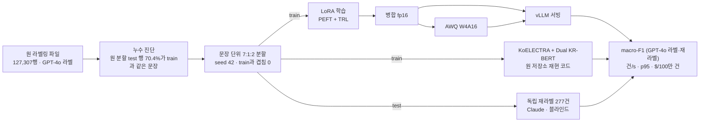

# 제주어 감정 분류: LoRA 소형 LLM 대 인코더 앙상블

[](https://github.com/parksungyun0411/jeju-emotion-lora/actions/workflows/ci.yml)   [](LICENSE)

졸업 프로젝트 [jeju-emotion-analysis](https://github.com/parksungyun0411/jeju-emotion-analysis)(제주어 7감정 분류)의 결과를 다시 검증하고, 같은 데이터에서 소형 LLM을 LoRA로 학습해 원 저장소의 재현 코드로 다시 학습한 KoELECTRA + Dual KR-BERT 앙상블과 비교하는 프로젝트입니다. 학습한 모델은 병합 → AWQ 4bit 양자화 → vLLM 서빙까지 이어서, 정확도와 함께 처리량과 100만 건당 비용을 한 표에 놓습니다.

이 README에서 '원 코드'는 원 저장소의 재현 코드 `src/jeju_kr_bert.py`입니다. 발표 때 점수를 만든 코드는 남아 있지 않아, 졸업 뒤(2026년 5월) 발표 자료의 구조와 하이퍼파라미터를 보고 다시 짠 이 코드를 고치지 않고 씁니다. 이 코드의 앙상블은 Dual-Gated KR-BERT와 KoELECTRA 두 모델만 결합해, 발표 자료의 4~6단계를 누적한 모델과 다릅니다(원 저장소 README '딥러닝 재현 코드').

다시 검증하면서 두 가지를 찾았습니다.

- **test 행의 70.4%가 train에도 있는 문장이었습니다.** 원 라벨링 파일은 감정별 행 수를 맞추려고 같은 문장을 한 감정 안에서 최대 52번 복제했고, 원 코드는 행 단위로 나눴습니다. 원 저장소 재현 코드의 절차·시드(seed 42)로 다시 나눈 행 단위 분할에서 test 25,462행 가운데 17,914행은 같은 제주어 문장이 train에 있습니다. 고유 문장으로 세면 test 18,557문장 중 63.0%입니다([reports/leakage.md](reports/leakage.md)). 발표 때의 시드는 남아 있지 않고(원 저장소 README), 원 보고서의 분할 크기는 전처리 후 127,313행 기준인데 지금 파일은 127,307행이라, 원 실험의 분할 그 자체가 아니라 같은 절차로 다시 나눈 분할입니다. 이 분할로 원 코드를 다시 돌리면 앙상블 macro-F1이 0.8393으로 원 README의 0.84와 맞습니다. 하지만 train에 같은 문장이 있는 test 행의 정확도는 0.970, 없는 행은 0.561입니다([reports/diagnostics/row_split_seen_unseen.md](reports/diagnostics/row_split_seen_unseen.md)). 이 저장소는 고유 문장 기준으로 다시 나눈 **문장 단위 분할**(test 10,496문장, train과 겹침 0)로 평가합니다.
- **감정 번호 1·2의 이름이 뒤바뀌어 있었습니다.** 원 코드의 보고서(원 저장소가 2026-10-28 04f61bd에서 고치기 전 판)와 이 저장소의 첫 구현은 1=슬픔, 2=행복으로 적었습니다. 원 파일의 감정 번호와 GPT-4o 감정 이름 열을 교차표로 대조하면 1=행복, 2=슬픔입니다(`tests/test_labels.py`). 인코더 지표는 번호로 계산해 영향이 없지만, 감정 이름을 프롬프트에 넣는 LLM은 영향을 받습니다. 그래서 정정 전 LLM 실행 결과는 [reports/metrics/_invalid_swapped_names/](reports/metrics/_invalid_swapped_names/)로 옮기고 쓰지 않습니다.

## 결과 (문장 단위 분할 test 10,496건)

| 구성 | 실행 환경 | macro-F1 (GPT-4o 라벨) | 정확도 | macro-F1 (독립 재라벨 277건) |
|---|---|---:|---:|---:|
| Dual-Gated KR-BERT (원 코드·원 하이퍼파라미터, 7 epoch) | Apple M4 MPS, bf16 autocast | 0.4806 | 0.5347 | 0.4393 |
| KoELECTRA (원 코드, 7 epoch) | Kaggle T4, fp32 | 0.4968 | 0.5389 | 0.4727 |
| KoELECTRA + Dual KR-BERT 앙상블 (α 0.50) | 위 두 모델의 test 확률 | 0.5192 | 0.5636 | 0.4902 |
| kanana-1.5-2.1b 제로샷 | Colab T4, vLLM fp16 | 0.2953 | 0.3978 | 0.2326 |
| kanana-1.5-2.1b 퓨샷 (클래스당 1) | Colab T4, vLLM fp16 | 0.3661 | 0.4626 | 0.4309 |
| **kanana-1.5-2.1b LoRA 병합** | Kaggle T4, vLLM fp16 | **0.5297** | 0.5673 | 0.4470 |
| kanana-1.5-2.1b LoRA AWQ 4bit | Kaggle T4, vLLM | 0.5247 | 0.5653 | 0.4519 |
| Midm-2.0-Mini 제로샷 | Kaggle T4, vLLM fp16 | 0.3151 | 0.4703 | 0.2882 |
| Midm-2.0-Mini 퓨샷 (클래스당 1) | Kaggle T4, vLLM fp16 | 0.3036 | 0.3673 | 0.3689 |
| Midm-2.0-Mini 제로샷 (LoRA용 템플릿) | Kaggle T4, vLLM fp16 | 0.2735 | 0.4417 | 0.3263 |
| Midm-2.0-Mini 퓨샷 (LoRA용 템플릿) | Kaggle T4, vLLM fp16 | 0.3395 | 0.4365 | 0.3601 |
| Midm-2.0-Mini LoRA 병합 | Kaggle T4, vLLM fp16 | 0.5163 | 0.5486 | 0.4252 |
| Midm-2.0-Mini LoRA AWQ 4bit | Kaggle T4, vLLM | 0.5076 | 0.5412 | 0.4075 |
| Qwen3-4B 제로샷 | Kaggle T4, vLLM fp16 | 0.3117 | 0.3941 | 0.2305 |
| Qwen3-4B 퓨샷 (클래스당 1) | Kaggle T4, vLLM fp16 | 0.3583 | 0.3861 | 0.3070 |
| Qwen3-4B LoRA 병합 | Kaggle T4, vLLM fp16 | 0.4738 | 0.5113 | 0.4002 |
| Qwen3-4B LoRA AWQ 4bit (fp32 보정) | Kaggle T4, vLLM | 0.4618 | 0.4967 | 0.3729 |

처리량과 비용 (Tesla T4 한 장, 문장 단위 test 5,000건. LLM은 앞 200건으로 예열한 뒤 다음 5,000건, 인코더는 앞 5,000건)

| 구성 | 측정 방식 | 건/s | p95 지연 | $/100만 건 |
|---|---|---:|---:|---:|
| KoELECTRA + Dual KR-BERT 앙상블 | PyTorch 배치 128, fp16 | 717.4 | — | 0.04 |
| kanana-1.5-2.1b LoRA 병합 | vLLM fp16, 동시 요청 64 | 85.3 | 864 ms | 0.35 |
| kanana-1.5-2.1b LoRA AWQ 4bit | vLLM, 동시 요청 64 | 86.4 | 854 ms | 0.34 |
| Midm-2.0-Mini LoRA 병합 | vLLM fp16, 동시 요청 64 | 86.8 | 878 ms | 0.34 |
| Midm-2.0-Mini LoRA AWQ 4bit | vLLM, 동시 요청 64 | 86.4 | 913 ms | 0.34 |
| Qwen3-4B LoRA 병합 | vLLM fp16, 동시 요청 64 | 50.6 | 1,345 ms | 0.59 |
| Qwen3-4B LoRA AWQ 4bit | vLLM, 동시 요청 64 | 52.1 | 1,293 ms | 0.57 |

- **이 데이터와 T4 조건에서 LoRA 소형 LLM이 인코더 앙상블보다 낫다는 근거는 없었습니다.** GPT-4o 라벨 기준 macro-F1은 kanana LoRA가 0.0105 높지만, test 문항을 다시 뽑는 부트스트랩(1,000회)의 95% 구간이 −0.0017 ~ +0.0226으로 0을 포함합니다. Midm LoRA는 −0.0029(−0.0150 ~ +0.0092)로 차이를 가리지 못했고, Qwen3-4B LoRA는 −0.0454(−0.0584 ~ −0.0326)로 앙상블보다 낮습니다([reports/diagnostics/](reports/diagnostics/), `make compare`). 독립 재라벨 277건에서는 점 추정치로 앙상블이 세 LoRA보다 높습니다(표본이 작아 구간은 내지 않았습니다). 처리량은 앙상블이 kanana LoRA의 8.4배, 100만 건당 비용은 약 8분의 1입니다.
- 모델이 크다고 점수가 높지 않았습니다. 가장 큰 Qwen3-4B가 세 LoRA 중 가장 낮았고 처리량도 kanana·Midm의 약 0.6배였습니다. kanana와 Midm의 차이(+0.0134, 95% 구간 +0.0027 ~ +0.0241)는 작지만 0을 넘습니다.
- AWQ 4bit는 fp16 대비 macro-F1이 kanana −0.0050(95% 구간 −0.0125 ~ +0.0020), Midm −0.0088(−0.0154 ~ −0.0019), Qwen3-4B −0.0120(−0.0198 ~ −0.0043)이었습니다. kanana만 구간이 0을 포함하고, Midm·Qwen3-4B는 작지만 실제로 떨어졌습니다. T4에서는 세 모델 모두 처리량 차이가 3% 안이었습니다.
- Qwen3-4B는 AWQ 보정을 fp16으로 하면 마지막 층에서 오차가 `inf`가 되어 멈춰, fp32로 보정했습니다. 같은 병합본을 transformers에서 fp16과 fp32로 돌린 test 512건의 라벨이 511건 같고 fp16 연산에 넘침이 없어, vLLM fp16 평가값은 그대로 씁니다([reports/diagnostics/qwen3_fp16.md](reports/diagnostics/qwen3_fp16.md)).
- Midm LoRA는 공식 채팅 템플릿에서 기본 시스템 문구를 빼고 assistant 차례를 모델이 실제로 내는 종료 토큰으로 닫게 고친 템플릿으로 학습했습니다([reports/diagnostics/midm_template.md](reports/diagnostics/midm_template.md)). 이 템플릿으로 잰 제로샷·퓨샷을 'LoRA용 템플릿' 행에 따로 적었습니다.
- 앙상블 α는 원 코드가 test에서 고른 값이라 앙상블 점수는 그만큼 낙관적입니다. 문장 단위 앙상블의 Dual KR-BERT는 로컬 Apple M4에서, KoELECTRA는 T4에서 학습했습니다.
- 비용은 Colab 종량제 요금으로 환산한 T4 $0.1069/h를 썼습니다(근거는 [docs/kaggle_t4.md](docs/kaggle_t4.md)). 측정은 Kaggle 무료 T4에서 했습니다. 인코더는 배치 순전파, LLM은 HTTP 서버 경유로 재서 인코더 쪽에는 서버 오버헤드가 빠져 있습니다.
- 수치는 [reports/metrics/](reports/metrics/)·[reports/throughput/](reports/throughput/)의 json에서 옮겼고, 전체 표는 [reports/RESULTS.md](reports/RESULTS.md)에 있습니다. 무효 응답(7개 라벨 밖 출력)은 모든 LLM 실행에서 0건입니다.
- 원 행 단위 분할(누수 있음)에서 다시 잰 원 코드 값은 Dual KR-BERT 0.8310, KoELECTRA 0.8199, 앙상블 0.8393입니다. 분할이 달라 위 표와 비교하지 않습니다.
- 독립 재라벨은 **사람이 아니라 Claude Opus 5.5가** GPT-4o 라벨을 보지 않고 붙인 라벨입니다. GPT-4o와의 일치는 40.1%(κ 0.300)이고, 불일치 대부분은 GPT-4o가 감정을 붙인 문장을 Claude가 중립으로 본 경우입니다. 정답 대용이 아니라 라벨 경계가 흔들리는 정도를 보는 참고값입니다([reviews/README.md](reviews/README.md)).

## 구현 범위

- 원 프로젝트와 같은 방식(행 단위 7:1:2 층화)과 원 저장소 재현 코드의 시드(seed 42)로 다시 나눈 행 단위 분할과, 같은 파일에 원 저장소 분할 함수를 돌린 결과와의 row_id 단위 대조
- 중복 문장 누수 진단(`make leakage`)과 문장 단위 분할(`make split-sentence`)
- 원 저장소의 재현 코드(`jeju_kr_bert.py`)는 고치지 않고 불러와, 분할 함수만 문장 단위로 바꿔 끼워 다시 학습(`python -m jeju_lora.run_original`)
- 재라벨 평가셋 도구: 감정별 층화 표본 추출, 블라인드 터미널 라벨링(검수자·시각·결정 기록), GPT-4o 대비 일치율·Cohen's κ 보고. 이번 Claude 재라벨은 이 터미널 도구를 쓰지 않고 한 번에 기록했습니다(아래 '재라벨은 블라인드로 했습니다')
- 제로샷·퓨샷 기준선(클래스당 1개 예시)
- PEFT LoRA + TRL `SFTTrainer` 학습(라벨 이름에만 손실), 어댑터 병합
- llm-compressor AWQ W4A16 양자화(보정 데이터는 train 분할에서만)
- vLLM OpenAI 호환 서버 평가: 출력을 7개 라벨로 제한하는 structured outputs, 부하 측정(건/s, p50·p95·p99)
- 원 앙상블 예측(npz)을 row_id에 붙여 재라벨로 다시 채점, 인코더 GPU 처리량 측정
- 원 행 단위 분할 test를 train에 있는 문장·없는 문장으로 나눠 채점(`make unseen-eval`)
- 두 구성의 macro-F1 차이를 같은 문항 부트스트랩으로 비교(`make compare`)
- GPU 시간당 요금을 입력으로 받는 결과·비용 표 생성(`reports/RESULTS.md`)

## 아키텍처



후보 모델은 상업 이용이 가능한 라이선스만 썼습니다. 라이선스는 2026-10-03에 각 모델 카드의 메타데이터와 LICENSE 파일로 확인했고, 커밋 해시는 [configs/models.yaml](configs/models.yaml)에 고정했습니다.

| 모델 | Hugging Face | 라이선스 |
|---|---|---|
| kanana-1.5-2.1b | `kakaocorp/kanana-1.5-2.1b-instruct-2505` | Apache-2.0 |
| Qwen3-4B | `Qwen/Qwen3-4B-Instruct-2507` | Apache-2.0 |
| Midm-2.0-Mini | `K-intelligence/Midm-2.0-Mini-Instruct` | MIT |
| ~~EXAONE 4.0 1.2B~~ | `LGAI-EXAONE/EXAONE-4.0-1.2B` | EXAONE AI Model License 1.2 - NC (비상업) → 제외 |

## 기술 스택

| 영역 | 기술 |
|---|---|
| 언어 |  |
| 학습 |     |
| 양자화·서빙 |   |
| 평가 |   |
| 실행 환경 |   |
| 코드 품질 |    |

GPU 단계는 무료 GPU에서 돌렸습니다. 처음에는 Google Colab T4 한 장([docs/colab_t4.md](docs/colab_t4.md)), VM이 끊긴 뒤로는 Kaggle T4 두 장([docs/kaggle_t4.md](docs/kaggle_t4.md))을 썼고, 절차·버전·막힌 곳은 각 문서에 있습니다. T4에는 bf16이 없어 학습·병합·서빙을 fp16으로 바꿨고, Colab 기본 torch·transformers·peft에 trl만 더했습니다. 24GB GPU·bf16 기준의 원래 계획과 고정 버전은 [docs/runpod_setup.md](docs/runpod_setup.md), [requirements/](requirements/)에 남겼습니다.

## 실행 방법

로컬에서는 Python 3.12와 uv만 있으면 테스트까지 돌아갑니다.

```bash
make setup-dev
make test        # 단위 테스트 + (torch가 있으면) 작은 랜덤 모델 학습 스모크
make lint
```

데이터가 있으면 누수를 진단하고 분할을 만듭니다. 데이터 파일은 저장소에 없습니다(아래 라이선스 참고).

```bash
make leakage          # reports/leakage.{md,json}
make split-sentence   # data/splits_sentence/*.jsonl, reports/split_manifest_sentence.json
make split && make verify-split   # 재현 코드의 절차·시드로 나눈 행 단위 분할, 같은 파일에서 원 저장소 분할 함수와 대조
```

원 보고서의 분할 크기(89,118 / 12,732 / 25,463)는 전처리 후 127,313행 기준이고 지금 파일은 127,307행입니다. 그래서 `make verify-split`은 크기 차이를 경고로 알리고(`STRICT=1`이면 실패), 같은 파일에 두 분할 함수를 돌린 row_id 순서가 같은지만 통과 조건으로 봅니다.

원 인코더는 원 코드와 같은 transformers 4.x 환경(`.venv-orig`: transformers 4.57.6, tokenizers 0.22.2, 이 저장소를 `--no-deps -e .`로 설치)에서 원 하이퍼파라미터(7 epoch, 배치 64) 그대로 돌립니다. 결과 표의 인코더 행은 아래 명령으로 만들었습니다. 원 저장소가 기본 위치에 없으면 `--original-repo`를 줍니다.

```bash
# 문장 단위 분할: Dual KR-BERT는 Apple M4 MPS에서 원 코드의 --fp16(bf16 autocast), KoELECTRA와 앙상블은 Kaggle T4에서 fp32
python -m jeju_lora.run_original --split sentence --amp --steps dual --out runs/original_sentence
python -m jeju_lora.run_original --split sentence --steps koelectra ensemble --out runs/original_sentence
# 원 행 단위 분할(누수 있음): Kaggle T4, fp32
python -m jeju_lora.run_original --split row --out runs/original_row

# test 확률(npz)을 row_id에 붙여 채점. α는 runs/*/step7_ensemble_report.txt에 원 코드가 고른 값
# --device·--precision은 json에 남기는 기록용 값이다(학습한 장치·정밀도)
python -m jeju_lora.encoder_eval --test data/splits_sentence/test.jsonl \
  --dual-npz runs/original_sentence/step3_dual_probs.npz \
  --single-npz runs/original_sentence/branch1_koelectra_probs.npz --alpha 0.5 \
  --gold reviews/relabel_claude/gold.jsonl \
  --device "Dual: mps (Apple M4), KoELECTRA: Tesla T4" --precision "Dual: bf16-autocast, KoELECTRA: fp32"
python -m jeju_lora.encoder_eval --test data/splits_sentence/test.jsonl \
  --dual-npz runs/original_sentence/step3_dual_probs.npz \
  --gold reviews/relabel_claude/gold.jsonl --tag encoder_dual_sentence \
  --device "mps (Apple M4)" --precision bf16-autocast
python -m jeju_lora.encoder_eval --test data/splits_sentence/test.jsonl \
  --dual-npz runs/original_sentence/branch1_koelectra_probs.npz \
  --gold reviews/relabel_claude/gold.jsonl --tag encoder_koelectra_sentence \
  --device "Tesla T4" --precision fp32
python -m jeju_lora.encoder_eval --test data/splits/test.jsonl \
  --dual-npz runs/original_row/step3_dual_probs.npz \
  --single-npz runs/original_row/branch1_koelectra_probs.npz --alpha 0.55 --tag encoder_ensemble_row \
  --device "Tesla T4" --precision fp32
python -m jeju_lora.encoder_eval --test data/splits/test.jsonl \
  --dual-npz runs/original_row/step3_dual_probs.npz --tag encoder_dual_row \
  --device "Tesla T4" --precision fp32
python -m jeju_lora.encoder_eval --test data/splits/test.jsonl \
  --dual-npz runs/original_row/branch1_koelectra_probs.npz --tag encoder_koelectra_row \
  --device "Tesla T4" --precision fp32
```

앙상블 채점은 `make original SPLIT=sentence|row`(MPS에서는 `AMP=1`)와 `make encoder-eval SPLIT=sentence|row ALPHA=… GOLD=… DEVICE=… PRECISION=…`로도 돌릴 수 있습니다. 위 채점 여섯 줄을 저장해 둔 npz로 다시 돌리면 [reports/metrics/](reports/metrics/)의 인코더 json과 같게 나오는 것을 2026-10-28에 확인했습니다.

GPU 단계는 `scripts/colab_t4.sh`로 단계별로 돌립니다(Colab VM과 Kaggle 커널에서 같은 스크립트, GPU 두 장이면 `PORT`로 vLLM 포트를 나눕니다). 서빙·양자화 venv 위치는 `SERVE_VENV`·`QUANT_VENV`로 바꿉니다. Colab은 기본값(`/content/venv-serve`, `/content/venv-quant`)을, Kaggle은 `PY=<기본 파이썬> SERVE_VENV=/tmp/vs QUANT_VENV=/tmp/vq`를 썼습니다. Kaggle에서는 `setup` 단계를 쓰지 않고, 학습 패키지를 `uv pip install --system --break-system-packages`로 기본 파이썬에 넣고 두 venv를 커널 스크립트에서 직접 만들었습니다([docs/kaggle_t4.md](docs/kaggle_t4.md) 환경·문제 1).

| 단계 | 명령 |
|---|---|
| 재라벨 평가셋 | `make review-sample` → `make review-label REVIEWER=…` → `make review-report` |
| 제로샷·퓨샷 | `bash scripts/colab_t4.sh baseline MODEL` |
| LoRA 학습·병합 | `bash scripts/colab_t4.sh train MODEL` → `merge MODEL` |
| 양자화·서빙 평가 | `bash scripts/colab_t4.sh quantize MODEL` → `eval MODEL fp16\|awq` |
| 재라벨로 다시 채점 | `make rescore GOLD=reviews/relabel_claude/gold.jsonl` |
| 원 행 단위 분할 누수 영향 | `make unseen-eval` |
| 두 구성 비교 | `make compare A=lora_kanana-1.5-2.1b_fp16 B=encoder_ensemble` |
| 건당 비용 | `bash scripts/colab_t4.sh bench-encoder` → `make report GPU_USD_PER_HOUR=… GPU_NAME=…` |

## 평가 규모

| 항목 | 수치 | 출처 |
|---|---:|---|
| 라벨링 데이터 (전처리 후) | 127,307행, 고유 제주어 문장 53,662개 (원 보고서의 분할 크기는 127,313행 기준) | [reports/leakage.md](reports/leakage.md) |
| 원 행 단위 분할 test 중 train에 같은 문장 | 17,914 / 25,462행 (70.4%), 고유 문장 11,685 / 18,557 (63.0%) | [reports/leakage.md](reports/leakage.md) |
| 같은 분할에서 원 앙상블 정확도 (train에 있는 문장 / 없는 문장) | 0.970 / 0.561 | [reports/diagnostics/row_split_seen_unseen.md](reports/diagnostics/row_split_seen_unseen.md) |
| 문장 단위 train / val / test | 84,307 / 5,248 / 10,496 | [reports/split_manifest_sentence.json](reports/split_manifest_sentence.json) |
| 독립 재라벨 | 277건 (Claude, 블라인드) | [reviews/relabel_claude/](reviews/relabel_claude/) |
| 비교 구성 | 원 인코더·앙상블 + 모델 3종 × 제로샷·퓨샷·LoRA fp16·LoRA AWQ | `configs/report.yaml` |

전체 표와 처리량·비용은 `make report`가 [reports/RESULTS.md](reports/RESULTS.md)로 만듭니다. 결과 파일 구성은 [reports/README.md](reports/README.md)에 있습니다.

## 프로젝트 구조

```text
jeju-emotion-lora/
├── src/jeju_lora/
│   ├── data.py, verify_split.py   원과 같은 절차의 행 단위 분할, 원 분할 함수와 대조
│   ├── leakage.py, sentence_split.py  누수 진단, 문장 단위 분할
│   ├── run_original.py            원 인코더 코드를 문장 단위 분할로 실행
│   ├── prompts.py, labels.py      프롬프트, 생성문 → 라벨 파싱, 감정 번호·이름
│   ├── train_lora.py, merge.py    LoRA 학습, 어댑터 병합
│   ├── quantize.py                AWQ W4A16
│   ├── predict.py, generation.py  vLLM·transformers 생성과 채점
│   ├── loadtest.py, bench_encoder.py  처리량·지연 측정
│   ├── encoder_eval.py, cost.py   원 앙상블 재채점, 결과·비용 표
│   ├── unseen_eval.py, compare.py 누수 영향 분리 채점, 두 구성 부트스트랩 비교
│   └── review/                    재라벨 표본·라벨링·일치도
├── configs/      후보 모델(라이선스·커밋 고정), 모델별 LoRA 설정(T4용 포함), 결과 표 구성
├── scripts/      Colab T4 단계 실행, GPU 서버 초기 설정, vLLM 실행 래퍼
├── reviews/      재라벨 기록 (Claude, 텍스트 없음)
├── reports/      스크립트가 만드는 결과, 실행 중 진단 기록
├── requirements/ 학습·서빙 환경 고정 버전 (원래 계획)
├── docs/         Colab·Kaggle T4 실행 기록, GPU 서버 계획
└── tests/        pytest (합성 데이터, 가짜 모델, 작은 랜덤 모델)
```

## 구현하면서 신경 쓴 점

- **모델보다 데이터를 먼저 셌습니다.** 같은 문장의 복제 수, train·test에 함께 들어간 문장 수를 모델 없이 데이터만으로 계산했습니다. 같은 문장에 다른 감정이 붙은 1,185문장은 모든 분할에서 뺐습니다.
- **감정 이름을 데이터로 확인했습니다.** 감정 번호 → 이름 대응을 코드 주석이 아니라 원 파일의 감정 번호 × GPT-4o 감정 이름 교차표로 정하고, 같은 대조를 테스트로 남겼습니다.
- **같은 test 문항인지 확인할 수 있게 했습니다.** 원 코드는 행 ID를 남기지 않아서, 전처리 직후 행 번호를 `row_id`로 붙였습니다. 원 저장소의 `stratified_split_712`를 AST로 꺼내 같은 데이터에 돌려 row_id 순서까지 비교합니다. 분할 결과는 문장 원문 없이 row_id 해시로 기록합니다.
- **QLoRA 대신 LoRA를 썼습니다.** 4bit로 학습하면 병합 대상 가중치가 원본과 달라져 "양자화 전후" 비교에 학습 단계의 양자화가 섞입니다. T4에서는 기반 가중치 fp16 + AMP fp16으로 학습했습니다.
- **출력을 라벨 7개로 묶었습니다.** vLLM structured outputs의 `choice`로 생성 자체를 라벨 이름으로 제한해, 모델 간 차이가 출력 형식 실수가 아니라 분류에서 나오게 했습니다. 제약 없이 돌리는 옵션(`--no-constrained`)과 파싱 실패율 지표도 남겼습니다.
- **재라벨은 블라인드로 했습니다.** GPT-4o 라벨을 보고 고르면 그 라벨에 끌려갑니다. 이번 재라벨은 터미널 도구로 한 건씩 판정하지 않았습니다. 표본에서 GPT-4o 라벨 열을 뺀 문항 파일(row_id·제주어·표준어만, 저장소 제외)을 만들어 Claude가 그 파일로 280건을 붙였고, 결과를 `decisions.jsonl`에 한 번에 기록했습니다. 그래서 280건의 시각이 모두 같고(2026-10-15 10:02:30 +09:00) `machine_label_shown`은 모두 false입니다. 재라벨이 GPU 실행보다 늦게 끝나도 저장된 예측으로 다시 채점합니다(`make rescore`).
- **양자화 실패와 평가값을 나눠 확인했습니다.** Qwen3-4B의 AWQ가 fp16 보정에서 멈췄을 때, 같은 fp16으로 잰 평가값도 넘침의 영향을 받았을 수 있었습니다. 병합본을 fp16과 fp32로 같은 test 512건에 돌려 층별 출력 크기와 라벨을 비교해 추론에는 넘침이 없다는 것을 확인했습니다. 실패는 보정 라이브러리가 제곱 오차 합을 fp16으로 계산하는 데서 나는 것으로 보여(라이브러리 코드와 실패 로그 기준), 보정만 fp32로 바꿨습니다.
- **처리량을 잴 때 정밀도를 확인했습니다.** 처음 잰 인코더 처리량(103.9건/s)의 기록을 보니 정밀도가 T4에 없는 bf16이었습니다. `torch.cuda.is_bf16_supported()`가 T4에서도 에뮬레이션으로 True를 돌려준 탓이라, compute capability로 고르게 고치고 fp16으로 다시 재 717.4건/s를 얻었습니다. 첫 값을 썼다면 앙상블이 LLM과 비슷한 속도로 보였을 것입니다.
- **비용은 공식만 고정했습니다.** `$/100만 건 = GPU $/h ÷ (건/s × 3600) × 10⁶`. 시간당 요금은 실행할 때 입력으로 받습니다.
- **학습·서빙·양자화 환경을 나눴습니다.** vllm 0.30.0은 compressed-tensors 0.17.0을, llmcompressor 0.14.0은 0.19.0을 요구해 한 환경에 설치되지 않습니다. Colab VM에서는 서빙용과 양자화용 venv를 따로 만들었습니다.

## 한계

- 독립 재라벨 277건은 사람이 아니라 Claude가 붙였습니다. GPT-4o와 Claude 모두 LLM이라, 사람 기준 정확도는 아직 없습니다.
- 무료 T4(15GB, bf16 없음)에 맞춰 LoRA는 fp16으로, train 84,307행 중 50,000행(seed 42)을 1 epoch만 학습합니다. 전체 1 epoch가 T4에서 약 3시간으로 잡혀 줄였고, 세 모델 모두 같은 50,000행을 씁니다.
- 인코더 실행 환경이 섞였습니다. 문장 단위 Dual KR-BERT는 Apple M4 MPS에서 원 코드의 `--fp16`(bf16 autocast)으로, 문장 단위 KoELECTRA와 원 행 단위 세 모델은 T4에서 fp32로 학습했습니다. 원 코드에는 GradScaler가 없어 T4에서 fp16 autocast로 바꿔 쓰지 않았습니다.
- 원 코드는 앙상블 가중치 α를 test 분할에서 고릅니다. 앙상블 값은 그만큼 낙관적이고, 이 저장소는 그 방식을 그대로 둡니다.
- 인코더를 학습할 때(2026-10-15~10-16) 쓴 원 코드는 감정 1·2의 이름이 뒤바뀐 판이라, 그때 나온 보고서 txt(`step*_report.txt`)는 이름이 뒤바뀐 채로 찍혀 있습니다. 원 저장소는 2026-10-28(04f61bd)에 이름을 고쳤습니다. 번호와 지표는 맞고, 이전 판 보고서의 감정별 표를 읽을 때 이름만 바꿔 읽어야 합니다.
- 인코더 처리량은 배치 순전파로, LLM은 HTTP 서버 경유로 잽니다. 인코더 쪽에는 서버 오버헤드가 빠져 있습니다. kanana·Midm 부하 측정은 같은 VM의 다른 GPU에서 학습이 돌던 시간에 했고(CPU 4개 공유), Qwen3-4B와 인코더는 다른 작업 없이 쟀습니다.
- 처리량은 한 번씩만 쟀습니다. 반복 측정 편차는 재지 않았습니다.
- LoRA는 모델마다 한 번(seed 42)만 학습했습니다. 부트스트랩 구간은 test 문항 표본의 흔들림만 반영하고, 학습 시드에 따른 편차는 들어 있지 않습니다.
- 계획에 있던 LoRA 랭크 비교(8/16/32)와 학습 데이터 비율 곡선(10/30/100%)은 이번 범위에서 뺐습니다.

## 라이선스

코드는 [MIT](LICENSE) 라이선스를 따릅니다. 원천 데이터는 AI Hub 「한국어 방언 발화(제주도)」이고 감정 라벨은 원 프로젝트에서 GPT-4o로 붙였습니다. AI Hub 데이터는 재배포가 제한되므로 데이터와 그 파생 텍스트는 저장소에 넣지 않았습니다. 저장소에는 row_id와 라벨 번호만 들어갑니다. 모델 가중치는 각 모델의 라이선스(위 표)를 따릅니다.
