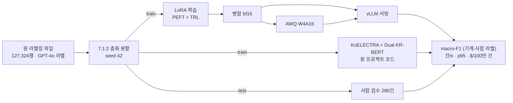

# 제주어 감정 분류: LoRA 소형 LLM 대 인코더 앙상블

[](https://github.com/parksungyun0411/jeju-emotion-lora/actions/workflows/ci.yml)   [](LICENSE)

졸업 프로젝트 [jeju-emotion-analysis](https://github.com/parksungyun0411/jeju-emotion-analysis)(제주어 7감정 분류)와 같은 데이터·분할·시드에서 소형 LLM 3종을 LoRA로 학습해, 기존 KoELECTRA + Dual KR-BERT 앙상블과 비교하는 프로젝트입니다. 학습한 모델은 병합 → AWQ 4bit 양자화 → vLLM 서빙까지 이어서, 정확도와 함께 처리량과 100만 건당 비용을 한 표에 놓습니다.

원 데이터의 감정 라벨은 GPT-4o가 붙였습니다. 그 라벨로만 평가하면 "GPT-4o를 얼마나 잘 따라 하는가"를 재게 되므로, test 분할에서 뽑은 280건에 사람이 다시 라벨을 붙인 평가셋을 따로 만들어 두 라벨로 모두 잽니다.

> **진행 중입니다.** 코드와 테스트는 있고, GPU 실행은 아직 하지 않았습니다. 아래 결과 표는 모두 측정 전입니다. 사람 검수 평가셋도 박성윤이 검수할 예정이라 아직 라벨이 없습니다.

## 구현 범위

- 원 프로젝트와 같은 7:1:2 층화 분할(seed 42) 재현과, 원 저장소 분할 함수와의 row_id 단위 대조
- 사람 검수 평가셋 도구: 감정별 층화 + 모델 불일치 문항 우선 표본 추출, 블라인드 터미널 라벨링(검수자·시각·결정 기록), GPT-4o 대비 일치율·Cohen's κ 보고
- 제로샷·퓨샷 기준선(클래스당 1개 예시)
- PEFT LoRA + TRL `SFTTrainer` 학습(라벨 이름에만 손실), 어댑터 병합
- llm-compressor AWQ W4A16 양자화(보정 데이터는 train 분할에서만)
- vLLM OpenAI 호환 서버 평가: 출력을 7개 라벨로 제한하는 structured outputs, 부하 측정(건/s, p50·p95·p99)
- 원 앙상블 예측(npz)을 row_id에 붙여 사람 검수 라벨로 다시 채점, 인코더 GPU 처리량 측정
- GPU 시간당 요금을 입력으로 받는 결과·비용 표 생성(`reports/RESULTS.md`)

## 아키텍처



후보 모델은 상업 이용이 가능한 라이선스만 썼습니다. 라이선스는 2026-10-03에 각 모델 카드의 메타데이터와 LICENSE 파일로 확인했고, 커밋 해시는 [configs/models.yaml](configs/models.yaml)에 고정했습니다.

| 모델 | Hugging Face | 라이선스 |
|---|---|---|
| kanana-1.5-2.1b | `kakaocorp/kanana-1.5-2.1b-instruct-2505` | Apache-2.0 |
| Qwen3-4B | `Qwen/Qwen3-4B-Instruct-2507` | Apache-2.0 |
| Midm-2.0-Mini | `K-intelligence/Midm-2.0-Mini-Instruct` | MIT |
| ~~EXAONE 4.0 1.2B~~ | `LGAI-EXAONE/EXAONE-4.0-1.2B` | EXAONE AI Model License 1.2 - NC (비상업) → 제외 |

## 기술 스택

| 영역 | 기술 |
|---|---|
| 언어 |  |
| 학습 |     |
| 양자화·서빙 |   |
| 평가 |   |
| 코드 품질 |    |

학습·양자화 환경과 서빙 환경은 나눴습니다. 고정 버전은 [requirements/train.txt](requirements/train.txt)(torch 2.14.0, transformers 5.17.0, peft 0.21.2, trl 1.14.1, llmcompressor 0.14.0)와 [requirements/serve.txt](requirements/serve.txt)(vllm 0.30.0)에 있습니다.

## 실행 방법

로컬에서는 Python 3.12와 uv만 있으면 테스트까지 돌아갑니다.

```bash
make setup-dev
make test        # 단위 테스트 + (torch가 있으면) 작은 랜덤 모델 학습 스모크
make lint
```

데이터가 있으면 분할을 만들고 원 프로젝트와 대조합니다. 데이터 파일은 저장소에 없습니다(아래 라이선스 참고).

```bash
make split DATA=data/raw/merged_jeju_balanced_sorted.xlsx
make verify-split
```

GPU 단계는 단계별 `make` 타깃으로 나눴습니다. 서버 준비, 실행 순서, 예상 GPU 시간은 [docs/runpod_setup.md](docs/runpod_setup.md)에 정리했습니다.

| 단계 | 명령 |
|---|---|
| ① 기존 수치 재현 | `make original` → `make encoder-eval ALPHA=…` |
| ② 사람 검수 평가셋 | `make review-sample` → `make review-label REVIEWER=…` → `make review-report` |
| ③ 제로샷·퓨샷 | `make zeroshot fewshot MODEL=qwen3-4b` |
| ④ LoRA 학습 | `make train MODEL=qwen3-4b` |
| ⑥ 병합·양자화·서빙 | `make merge quantize MODEL=…` → `make eval-lora MODEL=… VARIANT=bf16\|awq` |
| ⑦ 건당 비용 | `make bench-encoder` → `make report GPU_USD_PER_HOUR=… GPU_NAME=…` |

## 평가

규모:

| 항목 | 수치 | 출처 |
|---|---:|---|
| 라벨링 데이터 | 127,324행 | 원 프로젝트 보고서 |
| train / val / test | 89,118 / 12,732 / 25,463 | 원 프로젝트 보고서 |
| 사람 검수 평가셋 | 280건 (계획, 검수 전) | `reviews/` |
| 비교 구성 | 원 앙상블 1 + 모델 3종 × 제로샷·퓨샷·LoRA bf16·LoRA AWQ | `configs/report.yaml` |

기준선은 원 프로젝트가 발표한 KoELECTRA + Dual KR-BERT 앙상블의 test F1-Macro **0.84**입니다([jeju-emotion-analysis](https://github.com/parksungyun0411/jeju-emotion-analysis)). 이 저장소에서는 같은 코드로 다시 학습한 값을 기준선으로 씁니다.

성능과 비용 (**측정 전**):

| 구성 | macro-F1 (기계 라벨) | macro-F1 (사람 검수) | 건/s | p95 | $/100만 건 |
|---|---:|---:|---:|---:|---:|
| KoELECTRA + Dual KR-BERT 앙상블 | | | | | |
| kanana-1.5-2.1b LoRA bf16 / AWQ | | | | | |
| Qwen3-4B LoRA bf16 / AWQ | | | | | |
| Midm-2.0-Mini LoRA bf16 / AWQ | | | | | |

제로샷·퓨샷을 포함한 전체 표는 `make report`가 [reports/RESULTS.md](reports/RESULTS.md)로 만듭니다. 결과 파일 구성은 [reports/README.md](reports/README.md)에 있습니다.

## 프로젝트 구조

```text
jeju-emotion-lora/
├── src/jeju_lora/
│   ├── data.py, verify_split.py   분할 재현과 원 프로젝트 대조
│   ├── prompts.py, labels.py      프롬프트, 생성문 → 라벨 파싱
│   ├── train_lora.py, merge.py    LoRA 학습, 어댑터 병합
│   ├── quantize.py                AWQ W4A16
│   ├── predict.py, generation.py  vLLM·transformers 생성과 채점
│   ├── loadtest.py, bench_encoder.py  처리량·지연 측정
│   ├── encoder_eval.py, cost.py   원 앙상블 재채점, 결과·비용 표
│   └── review/                    사람 검수 표본·라벨링·일치도
├── configs/      후보 모델(라이선스·커밋 고정), 모델별 LoRA 설정, 결과 표 구성
├── scripts/      GPU 서버 초기 설정, vLLM 실행 래퍼
├── reviews/      사람 검수 기록 (검수 전)
├── reports/      스크립트가 만드는 결과 (측정 전)
├── requirements/ 학습·서빙 환경 고정 버전
├── docs/         GPU 서버 실행 가이드
└── tests/        pytest (합성 데이터, 가짜 모델, 작은 랜덤 모델)
```

## 구현하면서 신경 쓴 점

- **같은 test 문항인지 확인할 수 있게 했습니다.** 원 코드는 행 ID를 남기지 않아서, 전처리 직후 행 번호를 `row_id`로 붙였습니다. 열이 늘어도 `train_test_split`이 고르는 행은 같다는 점을 테스트로 확인했고, 원 저장소의 `stratified_split_712`를 AST로 꺼내 같은 데이터에 돌려 row_id 순서까지 비교합니다. 원 보고서의 분할 크기(89,118 / 12,732 / 25,463)도 같이 확인합니다.
- **QLoRA 대신 bf16 LoRA를 썼습니다.** 4B 이하 모델은 24GB GPU에 bf16으로 올라갑니다. 4bit로 학습하면 병합 대상 가중치가 원본과 달라져 "양자화 전후" 비교에 학습 단계의 양자화가 섞입니다.
- **출력을 라벨 7개로 묶었습니다.** vLLM structured outputs의 `choice`로 생성 자체를 라벨 이름으로 제한해, 모델 간 차이가 출력 형식 실수가 아니라 분류에서 나오게 했습니다. 제약 없이 돌리는 옵션(`--no-constrained`)과 파싱 실패율 지표도 남겼습니다.
- **사람 검수는 블라인드가 기본입니다.** GPT-4o 라벨을 보고 고르면 그 라벨에 끌려갑니다. 판정마다 검수자·시각·결정을 한 줄씩 바로 기록해 중단 후 이어서 할 수 있고, 검수가 GPU 실행보다 늦게 끝나면 저장된 예측으로 다시 채점합니다(`make rescore`).
- **비용은 공식만 고정했습니다.** `$/100만 건 = GPU $/h ÷ (건/s × 3600) × 10⁶`. 시간당 요금은 실행할 때 입력으로 받습니다.
- **학습과 서빙 환경을 나눴습니다.** vllm 0.30.0은 compressed-tensors 0.17.0을, llmcompressor 0.14.0은 0.19.0을 요구해 한 환경에 설치되지 않습니다. 두 환경 모두 Linux 기준으로 의존성 해석이 되는 것만 확인했습니다.

## 한계

- GPU 단계는 한 번도 실행하지 않았습니다. 로컬에서 확인한 것은 분할·프롬프트·파싱·지표·비용 계산·설정 검증과, CPU에서 작은 랜덤 모델로 학습 → 병합 → 생성이 2스텝 도는 것까지입니다.
- 원 라벨링 파일(`merged_jeju_balanced_sorted.xlsx`)을 이 Mac에서 찾지 못했습니다. 실제 데이터로 분할을 대조한 적은 아직 없고, 파일을 찾지 못하면 같은 분할 비교가 성립하지 않습니다.
- 원 프로젝트의 앙상블 가중치 α는 test 분할에서 골랐습니다. 기준선 0.84는 그만큼 낙관적인 값이고, 이 저장소는 그 α를 그대로 씁니다.
- 인코더 처리량은 배치 순전파로, LLM은 HTTP 서버 경유로 잽니다. 인코더 쪽에는 서버 오버헤드가 빠져 있습니다.
- 검수자는 1명으로 계획했습니다. 검수자 간 일치도는 두 번째 검수자가 있을 때만 나옵니다.
- llm-compressor가 저장한 AWQ 체크포인트를 vLLM 0.30.0이 읽는지는 확인하지 않았습니다(compressed-tensors 버전 차이). 대응 방법은 실행 가이드에 적었습니다.
- 계획에 있던 LoRA 랭크 비교(8/16/32)와 학습 데이터 비율 곡선(10/30/100%)은 이번 범위에서 뺐습니다.

## 라이선스

코드는 [MIT](LICENSE) 라이선스를 따릅니다. 원천 데이터는 AI Hub 「한국어 방언 발화(제주도)」이고 감정 라벨은 원 프로젝트에서 GPT-4o로 붙였습니다. AI Hub 데이터는 재배포가 제한되므로 데이터와 그 파생 텍스트는 저장소에 넣지 않았습니다. 저장소에는 row_id와 라벨 번호만 들어갑니다. 모델 가중치는 각 모델의 라이선스(위 표)를 따릅니다.
