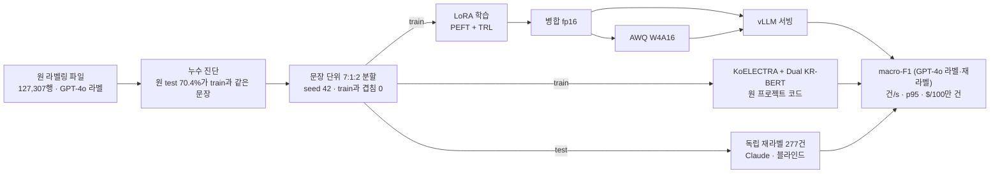

# 제주어 감정 분류: LoRA 소형 LLM 대 인코더 앙상블

[](https://github.com/parksungyun0411/jeju-emotion-lora/actions/workflows/ci.yml)   [](LICENSE)

졸업 프로젝트 [jeju-emotion-analysis](https://github.com/parksungyun0411/jeju-emotion-analysis)(제주어 7감정 분류)의 결과를 다시 검증하고, 같은 데이터에서 소형 LLM을 LoRA로 학습해 원 프로젝트의 KoELECTRA + Dual KR-BERT 앙상블과 비교하는 프로젝트입니다. 학습한 모델은 병합 → AWQ 4bit 양자화 → vLLM 서빙까지 이어서, 정확도와 함께 처리량과 100만 건당 비용을 한 표에 놓습니다.

다시 검증하면서 두 가지를 찾았습니다.

- **test 문장의 70.4%가 train에도 있었습니다.** 원 라벨링 파일은 감정별 행 수를 맞추려고 같은 문장을 최대 56번 복제했고, 원 코드는 행 단위로 나눴습니다. 그래서 원 분할 test 25,462행 가운데 17,914행은 같은 제주어 문장이 train에 있습니다([reports/leakage.md](reports/leakage.md)). 이 저장소는 고유 문장 기준으로 다시 나눈 **문장 단위 분할**(test 10,496문장, train과 겹침 0)로 평가합니다.
- **감정 번호 1·2의 이름이 뒤바뀌어 있었습니다.** 원 코드의 보고서와 이 저장소의 첫 구현은 1=슬픔, 2=행복으로 적었습니다. 원 파일의 감정 번호와 GPT-4o 감정 이름 열을 교차표로 대조하면 1=행복, 2=슬픔입니다(`tests/test_labels.py`). 인코더 지표는 번호로 계산해 영향이 없지만, 감정 이름을 프롬프트에 넣는 LLM은 영향을 받습니다. 그래서 정정 전 LLM 실행 결과는 [reports/metrics/_invalid_swapped_names/](reports/metrics/_invalid_swapped_names/)로 옮기고 쓰지 않습니다.

> **진행 중입니다.** 누수 진단, 문장 단위 분할, Dual KR-BERT 재학습, kanana 제로샷·퓨샷, 독립 재라벨 277건까지 측정했습니다. KoELECTRA·앙상블, LoRA 학습·양자화, 나머지 모델 기준선은 무료 Colab T4에서 다시 돌리는 중입니다. 아래 표의 '측정 중'은 아직 값이 없다는 뜻입니다.

## 결과 (문장 단위 분할 test 10,496건)

| 구성 | 실행 환경 | macro-F1 (GPT-4o 라벨) | 정확도 | macro-F1 (독립 재라벨 277건) |
|---|---|---:|---:|---:|
| Dual-Gated KR-BERT (원 코드·원 하이퍼파라미터, 7 epoch) | Apple M4 MPS, bf16 autocast | 0.4806 | 0.5347 | 0.4393 |
| KoELECTRA (원 코드) | Colab T4, fp32 | 측정 중 | 측정 중 | 측정 중 |
| KoELECTRA + Dual KR-BERT 앙상블 | | 측정 중 | 측정 중 | 측정 중 |
| kanana-1.5-2.1b 제로샷 | Colab T4, vLLM fp16 | 0.2953 | 0.3978 | 0.2326 |
| kanana-1.5-2.1b 퓨샷 (클래스당 1) | Colab T4, vLLM fp16 | 0.3661 | 0.4626 | 0.4309 |
| kanana-1.5-2.1b LoRA fp16 / AWQ | Colab T4 | 측정 중 | 측정 중 | 측정 중 |
| Midm-2.0-Mini 제로샷·퓨샷·LoRA | Colab T4 | 측정 중 | 측정 중 | 측정 중 |
| Qwen3-4B 제로샷·퓨샷 | Colab T4 | 측정 중 | 측정 중 | 측정 중 |

- 수치는 [reports/metrics/](reports/metrics/)의 json에서 옮겼고, 전체 표는 [reports/RESULTS.md](reports/RESULTS.md)에 있습니다. 무효 응답(7개 라벨 밖 출력)은 두 kanana 실행 모두 0건입니다.
- 원 프로젝트 README는 앙상블 F1-Macro 0.84를 행 단위 분할 파이프라인(누수 있음)의 값으로 적었습니다. 분할이 달라 이 표와 비교하지 않습니다. 같은 코드를 원 행 단위 분할로 다시 돌린 값과, 그중 train에 없는 문장만 따로 잰 값은 측정 중입니다.
- 독립 재라벨은 **사람이 아니라 Claude Opus 5.5가** GPT-4o 라벨을 보지 않고 붙인 라벨입니다. GPT-4o와의 일치는 40.1%(κ 0.300)이고, 불일치 대부분은 GPT-4o가 감정을 붙인 문장을 Claude가 중립으로 본 경우입니다. 정답 대용이 아니라 라벨 경계가 흔들리는 정도를 보는 참고값입니다([reviews/README.md](reviews/README.md)).

## 구현 범위

- 원 프로젝트와 같은 7:1:2 층화 분할(seed 42) 재현과, 원 저장소 분할 함수와의 row_id 단위 대조
- 중복 문장 누수 진단(`make leakage`)과 문장 단위 분할(`make split-sentence`)
- 원 프로젝트 인코더 코드는 고치지 않고 불러와, 분할 함수만 문장 단위로 바꿔 끼워 다시 학습(`python -m jeju_lora.run_original`)
- 재라벨 평가셋 도구: 감정별 층화 표본 추출, 블라인드 터미널 라벨링(검수자·시각·결정 기록), GPT-4o 대비 일치율·Cohen's κ 보고
- 제로샷·퓨샷 기준선(클래스당 1개 예시)
- PEFT LoRA + TRL `SFTTrainer` 학습(라벨 이름에만 손실), 어댑터 병합
- llm-compressor AWQ W4A16 양자화(보정 데이터는 train 분할에서만)
- vLLM OpenAI 호환 서버 평가: 출력을 7개 라벨로 제한하는 structured outputs, 부하 측정(건/s, p50·p95·p99)
- 원 앙상블 예측(npz)을 row_id에 붙여 재라벨로 다시 채점, 인코더 GPU 처리량 측정
- GPU 시간당 요금을 입력으로 받는 결과·비용 표 생성(`reports/RESULTS.md`)

## 아키텍처



후보 모델은 상업 이용이 가능한 라이선스만 썼습니다. 라이선스는 2026-10-03에 각 모델 카드의 메타데이터와 LICENSE 파일로 확인했고, 커밋 해시는 [configs/models.yaml](configs/models.yaml)에 고정했습니다.

| 모델 | Hugging Face | 라이선스 |
|---|---|---|
| kanana-1.5-2.1b | `kakaocorp/kanana-1.5-2.1b-instruct-2505` | Apache-2.0 |
| Qwen3-4B | `Qwen/Qwen3-4B-Instruct-2507` | Apache-2.0 |
| Midm-2.0-Mini | `K-intelligence/Midm-2.0-Mini-Instruct` | MIT |
| ~~EXAONE 4.0 1.2B~~ | `LGAI-EXAONE/EXAONE-4.0-1.2B` | EXAONE AI Model License 1.2 - NC (비상업) → 제외 |

## 기술 스택

| 영역 | 기술 |
|---|---|
| 언어 |  |
| 학습 |     |
| 양자화·서빙 |   |
| 평가 |   |
| 실행 환경 |  |
| 코드 품질 |    |

GPU 단계는 무료 Google Colab T4 한 장에서 돌렸습니다. 절차·버전·막힌 곳은 [docs/colab_t4.md](docs/colab_t4.md)에 있습니다. T4에는 bf16이 없어 학습·병합·서빙을 fp16으로 바꿨고, Colab 기본 torch·transformers·peft에 trl만 더했습니다. 24GB GPU·bf16 기준의 원래 계획과 고정 버전은 [docs/runpod_setup.md](docs/runpod_setup.md), [requirements/](requirements/)에 남겼습니다.

## 실행 방법

로컬에서는 Python 3.12와 uv만 있으면 테스트까지 돌아갑니다.

```bash
make setup-dev
make test        # 단위 테스트 + (torch가 있으면) 작은 랜덤 모델 학습 스모크
make lint
```

데이터가 있으면 누수를 진단하고 분할을 만듭니다. 데이터 파일은 저장소에 없습니다(아래 라이선스 참고).

```bash
make leakage          # reports/leakage.{md,json}
make split-sentence   # data/splits_sentence/*.jsonl, reports/split_manifest_sentence.json
make split && make verify-split   # 원 행 단위 분할 재현과 원 저장소 대조
```

GPU 단계는 Colab VM에서 `scripts/colab_t4.sh`로 단계별로 돌립니다.

| 단계 | 명령 |
|---|---|
| 원 인코더 재학습 | `python -m jeju_lora.run_original --split sentence --steps dual koelectra ensemble --out runs/original_sentence` |
| 재라벨 평가셋 | `make review-sample` → `make review-label REVIEWER=…` → `make review-report` |
| 제로샷·퓨샷 | `bash scripts/colab_t4.sh baseline MODEL` |
| LoRA 학습·병합 | `bash scripts/colab_t4.sh train MODEL` → `merge MODEL` |
| 양자화·서빙 평가 | `bash scripts/colab_t4.sh quantize MODEL` → `eval MODEL fp16\|awq` |
| 재라벨로 다시 채점 | `make rescore GOLD=reviews/relabel_claude/gold.jsonl` |
| 건당 비용 | `bash scripts/colab_t4.sh bench-encoder` → `make report GPU_USD_PER_HOUR=… GPU_NAME=…` |

## 평가 규모

| 항목 | 수치 | 출처 |
|---|---:|---|
| 라벨링 데이터 (전처리 후) | 127,307행, 고유 제주어 문장 53,662개 | [reports/leakage.md](reports/leakage.md) |
| 원 행 단위 분할 test 중 train에 같은 문장 | 17,914 / 25,462행 (70.4%) | [reports/leakage.md](reports/leakage.md) |
| 문장 단위 train / val / test | 84,307 / 5,248 / 10,496 | [reports/split_manifest_sentence.json](reports/split_manifest_sentence.json) |
| 독립 재라벨 | 277건 (Claude, 블라인드) | [reviews/relabel_claude/](reviews/relabel_claude/) |
| 비교 구성 | 원 인코더·앙상블 + 모델 3종 × 제로샷·퓨샷·LoRA fp16·LoRA AWQ | `configs/report.yaml` |

전체 표와 처리량·비용은 `make report`가 [reports/RESULTS.md](reports/RESULTS.md)로 만듭니다. 결과 파일 구성은 [reports/README.md](reports/README.md)에 있습니다.

## 프로젝트 구조

```text
jeju-emotion-lora/
├── src/jeju_lora/
│   ├── data.py, verify_split.py   원 분할 재현과 원 프로젝트 대조
│   ├── leakage.py, sentence_split.py  누수 진단, 문장 단위 분할
│   ├── run_original.py            원 인코더 코드를 문장 단위 분할로 실행
│   ├── prompts.py, labels.py      프롬프트, 생성문 → 라벨 파싱, 감정 번호·이름
│   ├── train_lora.py, merge.py    LoRA 학습, 어댑터 병합
│   ├── quantize.py                AWQ W4A16
│   ├── predict.py, generation.py  vLLM·transformers 생성과 채점
│   ├── loadtest.py, bench_encoder.py  처리량·지연 측정
│   ├── encoder_eval.py, cost.py   원 앙상블 재채점, 결과·비용 표
│   └── review/                    재라벨 표본·라벨링·일치도
├── configs/      후보 모델(라이선스·커밋 고정), 모델별 LoRA 설정(T4용 포함), 결과 표 구성
├── scripts/      Colab T4 단계 실행, GPU 서버 초기 설정, vLLM 실행 래퍼
├── reviews/      재라벨 기록 (Claude, 텍스트 없음)
├── reports/      스크립트가 만드는 결과, 실행 중 진단 기록
├── requirements/ 학습·서빙 환경 고정 버전 (원래 계획)
├── docs/         Colab T4 실행 기록, GPU 서버 계획
└── tests/        pytest (합성 데이터, 가짜 모델, 작은 랜덤 모델)
```

## 구현하면서 신경 쓴 점

- **모델보다 데이터를 먼저 셌습니다.** 같은 문장의 복제 수, train·test에 함께 들어간 문장 수를 모델 없이 데이터만으로 계산했습니다. 같은 문장에 다른 감정이 붙은 1,185문장은 모든 분할에서 뺐습니다.
- **감정 이름을 데이터로 확인했습니다.** 감정 번호 → 이름 대응을 코드 주석이 아니라 원 파일의 감정 번호 × GPT-4o 감정 이름 교차표로 정하고, 같은 대조를 테스트로 남겼습니다.
- **같은 test 문항인지 확인할 수 있게 했습니다.** 원 코드는 행 ID를 남기지 않아서, 전처리 직후 행 번호를 `row_id`로 붙였습니다. 원 저장소의 `stratified_split_712`를 AST로 꺼내 같은 데이터에 돌려 row_id 순서까지 비교합니다. 분할 결과는 문장 원문 없이 row_id 해시로 기록합니다.
- **QLoRA 대신 LoRA를 썼습니다.** 4bit로 학습하면 병합 대상 가중치가 원본과 달라져 "양자화 전후" 비교에 학습 단계의 양자화가 섞입니다. T4에서는 기반 가중치 fp16 + AMP fp16으로 학습했습니다.
- **출력을 라벨 7개로 묶었습니다.** vLLM structured outputs의 `choice`로 생성 자체를 라벨 이름으로 제한해, 모델 간 차이가 출력 형식 실수가 아니라 분류에서 나오게 했습니다. 제약 없이 돌리는 옵션(`--no-constrained`)과 파싱 실패율 지표도 남겼습니다.
- **재라벨은 블라인드로 했습니다.** GPT-4o 라벨을 보고 고르면 그 라벨에 끌려갑니다. 판정마다 검수자·시각·결정을 한 줄씩 기록하고, 재라벨이 GPU 실행보다 늦게 끝나도 저장된 예측으로 다시 채점합니다(`make rescore`).
- **비용은 공식만 고정했습니다.** `$/100만 건 = GPU $/h ÷ (건/s × 3600) × 10⁶`. 시간당 요금은 실행할 때 입력으로 받습니다.
- **학습·서빙·양자화 환경을 나눴습니다.** vllm 0.30.0은 compressed-tensors 0.17.0을, llmcompressor 0.14.0은 0.19.0을 요구해 한 환경에 설치되지 않습니다. Colab VM에서는 서빙용과 양자화용 venv를 따로 만들었습니다.

## 한계

- 독립 재라벨 277건은 사람이 아니라 Claude가 붙였습니다. GPT-4o와 Claude 모두 LLM이라, 사람 기준 정확도는 아직 없습니다.
- 무료 T4(15GB, bf16 없음)에 맞춰 LoRA는 fp16으로, train 84,307행 중 50,000행(seed 42)을 1 epoch만 학습합니다. 전체 1 epoch가 T4에서 약 3시간으로 잡혀 줄였고, 세 모델 모두 같은 50,000행을 씁니다.
- 인코더 실행 환경이 섞였습니다. Dual KR-BERT는 Apple M4 MPS에서 원 코드의 `--fp16`(bf16 autocast)으로, KoELECTRA는 T4에서 fp32로 학습합니다. 원 코드에는 GradScaler가 없어 T4에서 fp16 autocast로 바꿔 쓰지 않았습니다.
- 원 코드는 앙상블 가중치 α를 test 분할에서 고릅니다. 앙상블 값은 그만큼 낙관적이고, 이 저장소는 그 방식을 그대로 둡니다.
- 원 코드의 보고서 txt(`step*_report.txt`)는 감정 1·2의 이름이 뒤바뀐 채로 찍힙니다. 번호와 지표는 맞고, 감정별 표를 읽을 때 이름만 바꿔 읽어야 합니다.
- 인코더 처리량은 배치 순전파로, LLM은 HTTP 서버 경유로 잽니다. 인코더 쪽에는 서버 오버헤드가 빠져 있습니다.
- llm-compressor가 저장한 AWQ 체크포인트를 vLLM 0.30.0이 읽는지는 아직 확인 중입니다(compressed-tensors 버전 차이).
- 계획에 있던 LoRA 랭크 비교(8/16/32)와 학습 데이터 비율 곡선(10/30/100%)은 이번 범위에서 뺐습니다.

## 라이선스

코드는 [MIT](LICENSE) 라이선스를 따릅니다. 원천 데이터는 AI Hub 「한국어 방언 발화(제주도)」이고 감정 라벨은 원 프로젝트에서 GPT-4o로 붙였습니다. AI Hub 데이터는 재배포가 제한되므로 데이터와 그 파생 텍스트는 저장소에 넣지 않았습니다. 저장소에는 row_id와 라벨 번호만 들어갑니다. 모델 가중치는 각 모델의 라이선스(위 표)를 따릅니다.
